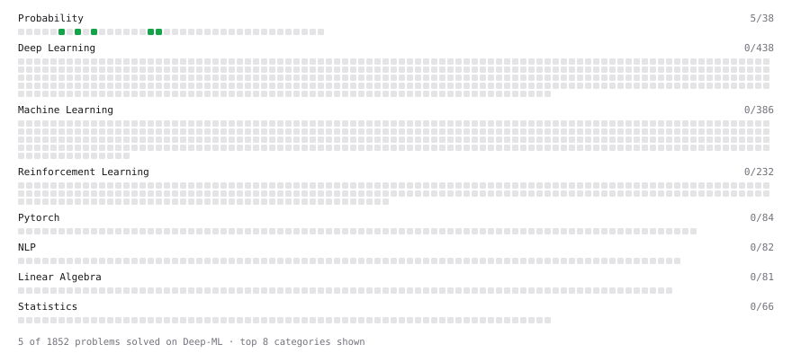

# Deep-ML

My machine learning practice from [Deep-ML](https://www.deep-ml.com). Every solution here was written by hand.

**10** solved · 6 problems · 0 labs · 4 math

[**Browse the interactive portfolio**](https://shankar-537.github.io/deep-ml/) to replay this filling in over time.

## Problems

| | Difficulty | Solved | |
| --- | --- | --- | --- |
| [Calculate Conditional Probability from Data](https://www.deep-ml.com/problems/168) | easy | 2026-10-26 | [solution](problems/0168-calculate-conditional-probability-from-data) |
| [Compute Posterior Probability using Bayes' Theorem](https://www.deep-ml.com/problems/336) | easy | 2026-10-27 | [solution](problems/0336-compute-posterior-probability-using-bayes-theorem) |
| [Expected Value and Variance of an n-Sided Die](https://www.deep-ml.com/problems/179) | easy | 2026-10-26 | [solution](problems/0179-expected-value-and-variance-of-an-n-sided-die) |
| [Sampling Distribution of the Mean](https://www.deep-ml.com/problems/181) | easy | 2026-10-26 | [solution](problems/0181-sampling-distribution-of-the-mean) |
| [Simulate Two-Dice Sum Distribution](https://www.deep-ml.com/problems/1139) | easy | 2026-10-27 | [solution](problems/1139-simulate-two-dice-sum-distribution) |
| [Compute Total Probability using Law of Total Probability](https://www.deep-ml.com/problems/244) | medium | 2026-10-30 | [solution](problems/0244-compute-total-probability-using-law-of-total-probability) |

## Math

| | Difficulty | Solved | |
| --- | --- | --- | --- |
| [Determinants and Trace](https://www.deep-ml.com/math-problems/11) | medium | 2026-10-30 | [solution](math/0011-determinants-and-trace) |
| [Inverse and Rank](https://www.deep-ml.com/math-problems/12) | medium | 2026-10-30 | [solution](math/0012-inverse-and-rank) |
| [Orthogonality and Projections](https://www.deep-ml.com/math-problems/14) | medium | 2026-10-30 | [solution](math/0014-orthogonality-and-projections) |
| [Solving Linear Systems](https://www.deep-ml.com/math-problems/13) | medium | 2026-10-30 | [solution](math/0013-solving-linear-systems) |

---

_This file is regenerated by Deep-ML on every push._
